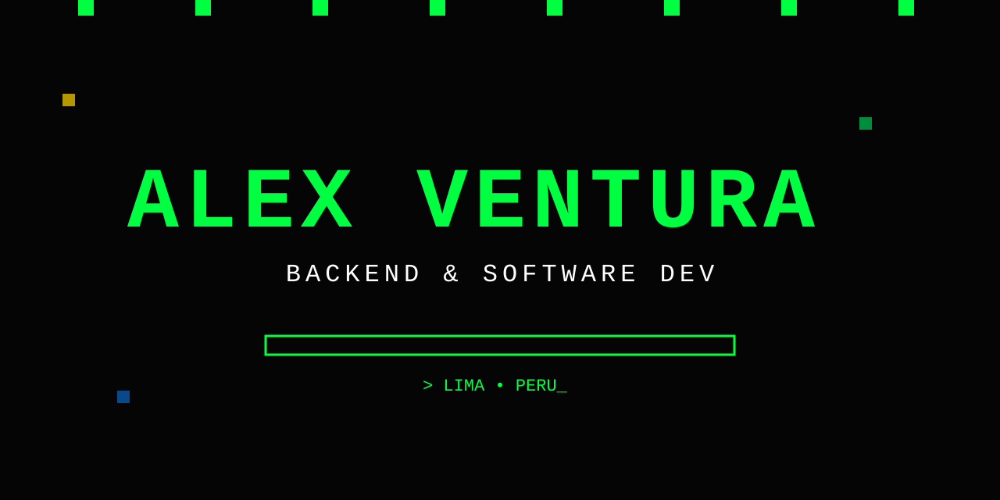

# Alex Ventura

**Systems Engineering student · Lima, Peru**

I build backend software and tools that solve concrete problems.
I learn by turning theory into working code, not notes.

[Versión en español](README.md)

---

### Stack

**Tools:** Git · GitHub · Linux · Docker (basic) · Postman

---

### Projects

| Project | What it solves | Stack |
| :--- | :--- | :--- |
| **[Project name](https://github.com/AlexArlyVentura10/repo)** | One line on the real problem and how it solves it. | Java · Spring Boot · PostgreSQL |
| **[Project name](https://github.com/AlexArlyVentura10/repo)** | One line on the real problem and how it solves it. | Python · FastAPI |

---

### Currently

- Going deep on backend development with Java and Spring Boot.
- Practicing relational database design and REST APIs.
- Looking for a first professional opportunity to contribute and grow.

---

### Contact

- Lima, Peru (GMT-5)
- LinkedIn: [alexarlyventura](https://www.linkedin.com/in/alexarlyventura)
- Email: [alexarly23@gmail.com](mailto:alexarly23@gmail.com)

Open to internships, small freelance projects and open source collaboration.
