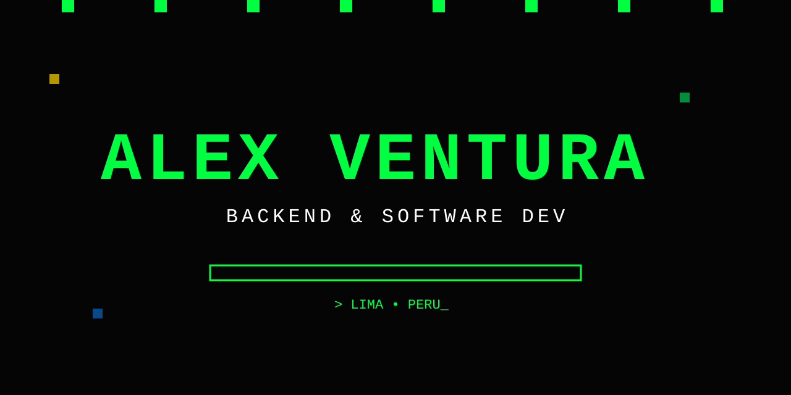

  

<svg xmlns="http://www.w3.org/2000/svg" width="1280" height="640" viewBox="0 0 1280 640">
  <!-- Fondo -->
  <rect width="1280" height="640" fill="#050505"/>

  <!-- Pixeles cayendo - efecto Matrix pixelado -->
  <g fill="#00FF41" shape-rendering="crispEdges">
    <rect x="100" y="0" width="20" height="20"><animate attributeName="y" values="-40;700" dur="3s" repeatCount="indefinite"/></rect>
    <rect x="250" y="0" width="20" height="20"><animate attributeName="y" values="-40;700" dur="4.5s" repeatCount="indefinite"/></rect>
    <rect x="400" y="0" width="20" height="20"><animate attributeName="y" values="-40;700" dur="2.8s" repeatCount="indefinite"/></rect>
    <rect x="550" y="0" width="20" height="20"><animate attributeName="y" values="-40;700" dur="5s" repeatCount="indefinite"/></rect>
    <rect x="700" y="0" width="20" height="20"><animate attributeName="y" values="-40;700" dur="3.6s" repeatCount="indefinite"/></rect>
    <rect x="850" y="0" width="20" height="20"><animate attributeName="y" values="-40;700" dur="4s" repeatCount="indefinite"/></rect>
    <rect x="1000" y="0" width="20" height="20"><animate attributeName="y" values="-40;700" dur="3.2s" repeatCount="indefinite"/></rect>
    <rect x="1150" y="0" width="20" height="20"><animate attributeName="y" values="-40;700" dur="4.8s" repeatCount="indefinite"/></rect>
  </g>

  <!-- Pixeles de colores flotando -->
  <g shape-rendering="crispEdges" opacity="0.7">
    <rect x="150" y="500" width="16" height="16" fill="#0A66C2"><animate attributeName="opacity" values="0;1;0" dur="2s" repeatCount="indefinite"/></rect>
    <rect x="1100" y="150" width="16" height="16" fill="#00C853"><animate attributeName="opacity" values="0;1;0" dur="2.5s" repeatCount="indefinite"/></rect>
    <rect x="80" y="120" width="16" height="16" fill="#FFD600"><animate attributeName="opacity" values="0;1;0" dur="1.8s" repeatCount="indefinite"/></rect>
  </g>

  <!-- Texto principal pixelado -->
  <text x="640" y="290" text-anchor="middle" font-family="'Courier New', monospace" font-size="110" font-weight="bold" letter-spacing="8" fill="#00FF41">
    ALEX VENTURA
    <animate attributeName="opacity" values="1;0.7;1" dur="1.5s" repeatCount="indefinite"/>
  </text>

  <!-- Subtitulo -->
  <text x="640" y="360" text-anchor="middle" font-family="'Courier New', monospace" font-size="32" letter-spacing="6" fill="#FFFFFF">
    BACKEND &amp; SOFTWARE DEV
  </text>

  <!-- Barra de carga pixelada animada -->
  <rect x="340" y="430" width="600" height="24" fill="none" stroke="#00FF41" stroke-width="3"/>
  <rect x="346" y="436" width="0" height="12" fill="#00FF41">
    <animate attributeName="width" values="0;588;0" dur="4s" repeatCount="indefinite"/>
  </rect>

  <text x="640" y="500" text-anchor="middle" font-family="'Courier New', monospace" font-size="22" fill="#00FF41">
    &gt; LIMA • PERU_ 
    <animate attributeName="opacity" values="1;0;1" dur="1s" repeatCount="indefinite"/>
  </text>
</svg>

<h1 style="color: red;">ALEX VENTURA</h1>

**Estudiante de Ingeniería de Sistemas · Lima, Perú**

Construyo software backend y herramientas que resuelven problemas concretos.
Aprendo llevando la teoría a código que funciona, no a apuntes.

---

### Stack

**Herramientas:** Git · GitHub · Linux · Docker (básico) · Postman

---

### Proyectos

| Proyecto | Qué resuelve | Stack |
| :--- | :--- | :--- |
| **[Nombre del proyecto](https://github.com/AlexArlyVentura10/repo)** | Una línea explicando el problema real y cómo lo resuelve. | Java · Spring Boot · PostgreSQL |
| **[Nombre del proyecto](https://github.com/AlexArlyVentura10/repo)** | Una línea explicando el problema real y cómo lo resuelve. | Python · FastAPI |
| **[Nombre del proyecto](https://github.com/AlexArlyVentura10/repo)** | Una línea explicando el problema real y cómo lo resuelve. | TypeScript · Node |

---

### Actualmente

- Profundizando en desarrollo backend con Java y Spring Boot.
- Practicando diseño de bases de datos relacionales y APIs REST.
- Buscando mi primera oportunidad profesional donde aportar y crecer.

---

### Contacto

- Lima, Perú (GMT-5)
- LinkedIn: [alexarlyventura](https://www.linkedin.com/in/alexarlyventura)
- Email: alexarly23@gmail.com

Abierto a prácticas, proyectos freelance pequeños y colaboración open source.
